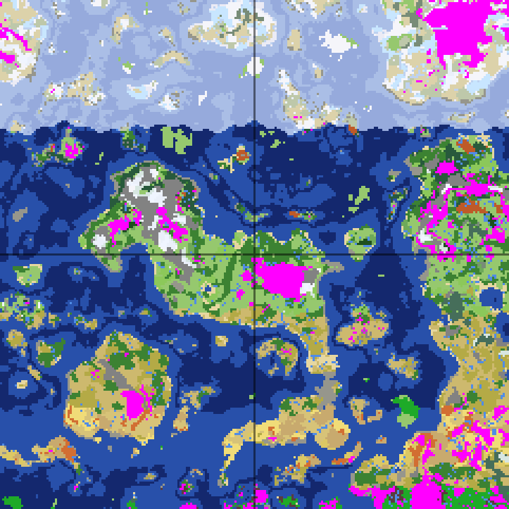

# Proud Mountain SMP 2.0.0

Modpack für **Minecraft 1.21.1 / NeoForge 21.1.256**: eine Welt für immer (*Forever World*), in der die Jahreszeiten dem echten Kalender folgen. Ein Frühling dauert drei echte Monate, im Winter schneit es in den gemäßigten Breiten, im Sommer stehen die Felder voll. Die Biome liegen in Klimazonen (Norden kalt, Süden heiß) auf großen Kontinenten und Inseln. Dazu Farmer's-Delight- und Let's-Do-Küche, Supplementaries, der sortierende Copper Golem aus 1.21.9, umstürzende Bäume, viele Strukturen, Mobs und Bosse.

Bis Version 1.0.0 hieß das Pack *Frostbound Colonies* (ewiger Winter mit Primal Winter, Cold Sweat, Create und MineColonies), das Repo `minecraft-modpack-frostbound-colonies`. GitHub liefert unter der alten Adresse weiter aus (auch die Raw-URLs), bestehende Prism-Instanzen und `PACKWIZ_URL`-Einträge funktionieren also weiter. Das gilt nur, solange niemand auf GitHub ein Repo mit dem alten Namen anlegt, deshalb den Server bei Gelegenheit auf die neue `PACKWIZ_URL` umstellen. Die interne Mod *Frostbound Tweaks* (Mod-ID `frostbound_tweaks`) behält ihren Namen, damit Configs und Testwelt-Daten gültig bleiben.

## Dateien

| Datei | Zweck |
|---|---|
| `dist/ProudMountainSMP-Prism.zip` | Prism-Launcher-Instanz mit Auto-Update (siehe [Installation](#installation-prism-launcher-mit-auto-update)) |
| `mods.resolved.json` | Exakte Projekt- und Datei-IDs aller Mods (Lock-Datei) |
| `packwiz/` | packwiz-Pack, aus dem die Prism-Instanzen und der Server ihre Updates holen. Configs, KubeJS-Skripte und Datapacks (`kubejs/data/`) werden direkt hier gepflegt (Quelle); `*.pw.toml`, `index.toml` und `pack.toml` erzeugt `tools/packwiz.py`, die nicht von Hand bearbeiten. Mods, die als identische Datei auf Modrinth liegen (95 von 106), werden von dort geladen, der Rest von CurseForge |
| `tools/` | `modlist.txt` (Modliste, alle Versionen gepinnt), `build.py` (Abhängigkeiten auflösen), `packwiz.py` (packwiz-Pack und Prism-Instanz bauen), `package.py` (CurseForge-ZIPs, bei Bedarf), `scale_structures.py` (Strukturdichte senken), `disable_structures.py` (schwebende Strukturen abschalten), `packwiz-installer-bootstrap.jar` (v0.0.3, steckt in der Prism-Instanz), `test/` (Testserver-Werkzeuge: `srv.sh`, `rcon.py`, `biomemap.js`/`biomemap.py` für Biomkarten, `analyze.py`, `surface.py`) |
| `server-overrides/` | Configs nur für den Server (AntiXray), `tools/packwiz.py` kopiert sie nach `packwiz/` |
| `frostbound-tweaks/` | Quelltext der eigenen Mod *Frostbound Tweaks* (NeoForge 1.21.1, bauen mit `./gradlew build`, braucht JDK 21, z. B. per `JAVA_HOME`) |
| `extra-mods/` | Fertige Jars eigener Mods. `tools/packwiz.py` (`EXTRA_MODS`) trägt sie mit Download direkt aus diesem Repo ins packwiz-Pack ein |
| `docs/biomkarte.png` | Biomkarte einer Testwelt (24 × 24 km), siehe [Welt](#welt-klimazonen-kontinente-biomes-o-plenty) |

Neu bauen: `python3 tools/build.py tools/modlist.txt mods.resolved.json`, dann `python3 tools/packwiz.py mods.resolved.json packwiz dist`.

## Installation (Prism Launcher mit Auto-Update)

1. [Prism Launcher](https://prismlauncher.org) installieren und mit dem Microsoft-Konto anmelden.
2. [`ProudMountainSMP-Prism.zip`](https://github.com/Stolzenberg/minecraft-modpack-proud-mountain-smp/raw/main/dist/ProudMountainSMP-Prism.zip) herunterladen und in Prism über *Instanz hinzufügen* → *Importieren* laden (oder die ZIP ins Prism-Fenster ziehen).
3. Instanz starten. Vor jedem Start gleicht `packwiz-installer` die Instanz mit `packwiz/` in diesem Repo ab und lädt nur Geändertes. Neue Mods kommen dazu, entfernte werden gelöscht. In der Serverliste steht schon „Proud Mountain SMP“ (`server.proud-mountain.com`), das kommt aus der `servers.dat` in der ZIP und wird nur beim Import angelegt.

Alle Mods kommen von Modrinth oder CurseForge mit erlaubtem Launcher-Download, es ist **kein manueller Download** mehr nötig.

**Bestehende Frostbound-Colonies-Instanzen** müssen nichts tun: Sie holen sich 2.0.0 beim nächsten Start selbst (gleiche Pack-URL). Alte Configs entfernter Mods (z. B. `config/coldsweat/`) bleiben als Dateileichen liegen und stören nicht.

Was ein Update **nicht** anfasst: `options.txt` (Grafik, Tasten, Sound), Welten, Serverliste, Screenshots, Minimap-Wegpunkte und `config/iris.properties` (eigene Shader-Einstellungen, als `preserve` markiert, nur bei der Erstinstallation geschrieben). Mitgelieferte Gameplay-Configs und KubeJS-Skripte werden bei Änderungen überschrieben, damit alle mit denselben Regeln spielen. Einzige Ausnahme in `options.txt`: Neu mitgelieferte [Resource Packs](#resource-packs) werden einmal eingeschaltet, abwählen bleibt danach dauerhaft.

**Update veröffentlichen:** Neu bauen (siehe oben), committen, pushen. GitHub liefert die neue Version nach spätestens ca. 5 Minuten aus, beim nächsten Start ziehen alle Instanzen nach.

**Server (Docker, `itzg/minecraft-server`):** `PACKWIZ_URL=https://raw.githubusercontent.com/Stolzenberg/minecraft-modpack-proud-mountain-smp/main/packwiz/pack.toml` setzen (zusammen mit `TYPE=NEOFORGE`, `VERSION`, `NEOFORGE_VERSION`). Der Container gleicht bei jedem Start ab und installiert nur die Server-Seite (ohne Client-Mods, mit AntiXray und CoreProtect). Nach einem Push `docker compose restart mc`. Ändert sich die NeoForge-Version, auch `NEOFORGE_VERSION` anpassen. Außerdem nötig: UDP-Port 24454 für Simple Voice Chat veröffentlichen (`24454:24454/udp`) und ein MariaDB-Container für CoreProtect, siehe [Server: Voice Chat und CoreProtect](#server-voice-chat-und-coreprotect). Ohne Docker: `java -jar packwiz-installer-bootstrap.jar -g -s server <URL>` im Serverordner vor dem Start.

**Umstieg von 1.0.0 auf dem Server: neue Welt nötig.** Die Klimazonen, Kontinente und BoP-Biome gibt es nur in neu generierten Chunks, die alte Welt ist zudem voller Primal-Winter-Schnee und -Eis, und Blöcke und Items von Create, Cold Sweat, den Weihnachts- und Kleidungs-Mods verschwinden beim Laden. Vor dem Wechsel die alte Welt sichern (Rucksäcke von Sophisticated Backpacks liegen in `data/`, Wegpunkte im Client), dann `world/` wegräumen und mit dem neuen Stand starten. `level-seed` nach Belieben setzen, Seed geheim halten.

## Welt: Klimazonen, Kontinente, Biomes O' Plenty

*Testwelt (Seed `frostbound-test`), 24 × 24 km, Spawn im Achsenkreuz, Norden oben. Blau: Ozean (hell: Eismeer, dunkel: Tiefsee), weiß: Schnee, beige: Tundra/Trockengebiete, gelb: Wüste, grün: Wiese, Wald, Dschungel, grau: Berge, magenta: Höhlenbiome (die Karte tastet auf y = 64 ab, unter Bergen liegt dort schon eine Höhle). Erzeugt mit `tools/test/biomemap.js` und `tools/test/biomemap.py`, ohne Chunks zu generieren.*

- **Gelände: Tectonic** (`config/tectonic.json`): große, zusammenhängende Gebirgszüge und Ebenen, Biome doppelt so breit wie Vanilla (`temperature_scale`/`vegetation_scale` 0,125), breitere Gebirgszüge (`erosion_scale` 0,18), keine Dschungel-Felssäulen. **Kontinente und Inseln:** `continents_scale` 0,08 (vorher 0,13) macht Kontinente und die Ozeane dazwischen deutlich größer, die eingebauten Tectonic-Inseln (`islands.enabled`) setzen große und kleine Inseln in die Meere. In der Testwelt sind 57 % Ozean und 43 % Land, der Spawn liegt auf einem Kontinent. Tectonic braucht Lithostitched, das nicht als Abhängigkeit eingetragen ist und deshalb in der Modliste steht.
  - Die Mod *Continents* (Stardust Labs) ist bewusst **nicht** drin: Sie und Tectonic überschreiben dieselbe Kontinentalitäts-Rauschfunktion, eine von beiden würde verlieren. Tectonic bringt dasselbe über `continents_scale` und Inseln mit.
- **Klimazonen: Natural Temperature** (`config/naturaltemperature-common.toml`): Die Biom-Temperatur hängt von der Breite ab (z-Achse), wie auf der Erde. Dadurch liegt nie eine Wüste neben einem Schneebiom, die Übergänge laufen über Taiga und Tundra bzw. Buschland und Savanne. Einstellungen: `equatorial_distance` 12.000 (Standard 50.000 wäre für einen Server viel zu weit), `equator_offset` −2.000 (Spawn mitten in der gemäßigten Zone statt an ihrem Südrand), `global_temperature_mitigation_percentage` 25 (gemäßigte Zone breiter, Extreme schmaler), `wave_magnification` 6 (Zonengrenzen gewellt statt gerade), `looping_world` (hinter den Polen wiederholt sich das Muster), GUI-Knopf im Hauptmenü aus.
  - Gemessen in der Testwelt (Landbiome je 1.000-Block-Streifen, ab Spawn): gemäßigt (Wiesen, Wälder, Ahorn, Lavendel, Obstgärten) von etwa 6.000 Blöcken nördlich bis 3.000 südlich, darin nur auf Berggipfeln Schnee (8–13 % des Landes). Ab etwa 6.000 bis 7.000 nördlich Tundra und Taiga, gemischt mit Schneebiomen (je etwa die Hälfte), dahinter Eismeer mit Inseln. Südlich von etwa 3.000 bis 10.000 Buschland, Savanne und Wüste, ab etwa 11.000 Dschungel.
  - Die Grenze zum Eismeer verläuft auf See als lange, nur leicht gewellte Linie. An Land sind die Übergänge fließend.
- **Biomes O' Plenty** (über TerraBlender): gut 50 zusätzliche Biome (Ahornwälder, Lavendelfelder, Obstgärten, Tundra, Buschland, Moore, Regenwald, Vulkane u. a.), die sich in die Klimazonen einsortieren. In der Testwelt etwa ein Drittel der Landfläche.
- **4× längere Tage** (Better Days, `config/betterdays-common.toml`: `daySpeed`/`nightSpeed` = 0,25): Ein Minecraft-Tag dauert 80 statt 20 Minuten (40 Minuten Tag, 40 Minuten Nacht). Beim Schlafen läuft die Zeit sanft schneller bis zum Morgen. Pflanzen wachsen in Echtzeit weiter, pro Spieltag also viermal so viel.
- **Strukturen:** Moog's Voyager, When Dungeons Arise, Explorify, Moog's Temples/Mineshafts/Nether/End, Dungeons and Taverns, YUNG's Better Dungeons, Repurposed Structures und Iglus.
- **Weniger Strukturen** (`tools/scale_structures.py` → `kubejs/data/<mod>/worldgen/structure_set/`): Die Abstände aller Struktur-Sets (Mods und Vanilla, außer Festungen) sind ×1,4 vergrößert, Moog's Voyager mit seinem vielen Kleinkram (Karren, Heuballen, Holzstapel) ×2.
- **Keine schwebenden Strukturen:** MSS (Moog's Soaring Structures) und Sky Whale Ship sind nicht im Pack. Sieben weitere Himmelsbauwerke sind per Datapack abgeschaltet (`tools/disable_structures.py` → `kubejs/data/<mod>/worldgen/structure/`, verweisen auf den leeren Biom-Tag `#frostbound:none`): die drei Heavenly-Dungeons, Mechanical Nest und Small Blimp (When Dungeons Arise) sowie die beiden Floating Islands (Moog's Voyager).

## Jahreszeiten (Serene Seasons, nach Kalender)
- **Serene Seasons** färbt Gras und Laub je nach Jahreszeit, lässt im Winter Schnee fallen und Wasser gefrieren, im Frühling taut es wieder. Regen und Gewitter sind je Saison unterschiedlich häufig. Kalender (Papier um eine Uhr) und Jahreszeiten-Sensor (Redstone) zeigen die Saison an, `/season get` ebenfalls.
- **Echter Kalender** (*Frostbound Tweaks* 2.0.0, `SeasonCalendar`): Jeder Monat ist eine Teilsaison. März, April, Mai = früher, mittlerer, später Frühling; Juni bis August Sommer; September bis November Herbst; Dezember bis Februar Winter. Innerhalb des Monats läuft die Saison tagesgenau mit (am 23. Oktober z. B. „Mid Autumn, Tag 404/548“). Alle zehn Sekunden wird der Zyklus aufs Datum gesetzt, Schlafen, Lags und Serverausfälle verschieben also nichts. Zeitzone `Europe/Berlin`, Einstellungen in `config/frostbound_tweaks-common.toml` (`calendar_seasons = false` gibt Serene Seasons die Zeit zurück, dann gilt auch `/season set` wieder; mit Kalender wird es nach spätestens 10 Sekunden zurückgesetzt).
  - Serene Seasons zählt die Saison in Tageszeit-Einheiten. `config/sereneseasons/seasons.toml`: `day_duration` 24.000 (Better Days lässt den Tag 24.000 Einheiten lang und dreht nur die Geschwindigkeit herunter), `sub_season_duration` 548 Spieltage ≈ ein Monat (548 × 80 Minuten = 30,4 Tage). Damit läuft Serene Seasons auch ohne Korrektur fast im Takt des Kalenders.
- **Welche Biome Jahreszeiten haben** (Biom-Tags in `kubejs/data/sereneseasons/tags/worldgen/biome/`, dazu die Tags, die Serene Seasons und BoP selbst mitbringen):

  | Gruppe | Biome | Verhalten |
  |---|---|---|
  | Vier Jahreszeiten | Ebene, Sonnenblumenebene, alle Wälder (Eiche, Birke, Dunkel-, Blumen-, Kirschwald), Wiese, Sumpf (abgeschwächte Färbung), Windgepeitschte Hügel/Wälder, Steinige Gipfel; BoP: Ahornwälder, Espenhain, Jacaranda, Woodland, Obstgarten, Lavendelfeld, Prärie, Weide, Grasland, Highland, Moor, Marsch, Wetland, Tundra (Schnee schon ab Spätherbst) u. a. | Laubfarben, Winterschnee, Frost auf Wasser, Saison-Regen |
  | Tropisch: Regen- und Trockenzeit, kein Schnee | Wüste, Badlands, Savanne, Dschungel, Mangrovensumpf, Pilzinsel, warmer Ozean; BoP: Bayou, Dryland, Floodplain, Fungal Jungle, Lush Desert/Savanna, Mediterranean Forest, Rainforest, Scrubland, Tropics, Vulkane, Wasteland | Laub bleibt grün. In Wüste, Savanne und Badlands regnet es ohnehin nie, dort ändert sich praktisch nichts |
  | Ganzjährig Winter | Verschneite Ebene, Eiszapfen, Verschneite Taiga, Verschneiter Strand, Schneehänge, Hain, Gefrorene und Zerklüftete Gipfel, Gefrorener Fluss, Eismeer; BoP: Auroral Garden, Snowblossom Grove, Snowy Coniferous Forest, Snowy Fir Clearing, Snowy Maple Woods, Wintry Origin Valley | bleiben verschneit, auch im Sommer taut nichts |
  | Keine Jahreszeiten | Taiga, Riesenfichten- und Riesenkiefern-Taiga; BoP: Coniferous Forest, Fir Clearing, Cold Desert | immer wie im Frühling, kein Schnee |
  | Unverändert (Serene-Seasons-Standard) | Ozeane, Flüsse, Strände, Steinküste, Höhlenbiome | keine saisonalen Effekte |

- **Feldfrüchte:** Alles, was Felder hat (Tag `minecraft:crops`: Vanilla, Farmer's Delight, Let's Do Farm & Charm), wächst von Frühling bis Herbst normal und im Winter **langsamer** (`out_of_season_crop_behavior = 0`, nichts stirbt ab). Winterfest sind die Pflanzen, die Serene Seasons, Farmer's Delight und Let's Do als Winterfrüchte führen, etwa Kohl und Süßbeeren. Im Winter helfen **Gewächshäuser**: Unter Glas wächst alles wie in seiner Saison. Tooltips an Saatgut zeigen die Saisons. *Seasonal Let's Do* bindet die Let's-Do-Pflanzen an Serene Seasons an.

## Copper Golem (Copper Age Backport)
- Der **Copper Golem aus Minecraft 1.21.9:** Kürbis auf einen Kupferblock setzen, der Golem erscheint, und an der Stelle des Kupferblocks steht eine **Kupfertruhe**. Er holt Items aus Kupfertruhen und bringt sie in normale Truhen, in denen schon dasselbe Item liegt. Er oxidiert mit der Zeit (mit Wachs aufhalten) und drückt ab und zu Kupferknöpfe. Dazu Kupfertruhen, -statuen, -laternen, -ketten, -gitter, -werkzeuge und -rüstung. Alles liegt im `minecraft:`-Namensraum, ein späterer Wechsel auf 1.21.10+ übernimmt die Blöcke.
- Der ältere Copper Golem aus **Friends & Foes** (drückt nur Knöpfe) ist abgeschaltet, auch in Dörfern, Ancient Cities und Trial Chambers (`config/friendsandfoes.json`). Die Kupferknöpfe und Blitzableiter-Oxidation von Friends & Foes bleiben an: Wenn man sie abschaltet, entfernt Friends & Foes Rezepte und bricht dabei mit einer NullPointerException das Laden der Datapacks ab (Konflikt mit KubeJS/ModernFix). Es gibt deshalb zwei Sorten Kupferknöpfe.
- Getestet (Testserver): Kupferblock und Kürbis ergeben `minecraft:copper_golem` und eine Kupfertruhe, kein Friends-&-Foes-Golem. 16 Eichenstämme aus der Kupfertruhe landen in der Truhe, in der schon ein Stamm lag. Die Bauerkennung ist nur über ihren Code-Einstieg geprüft (ohne echten Spieler).

## Bäume fällen (Panda's Falling Trees)
- Wer einen Baumstamm **mit der Axt** abbaut, fällt den ganzen Baum: Er kippt zur Seite, schlägt auf und zerfällt in Stämme, Setzlinge und Laub-Drops. Größere Bäume brauchen länger, die Axt nutzt sich pro Stamm ab, und es kostet etwas mehr Hunger.
- **Schleichen** baut nur den einzelnen Block ab. Ohne Axt (Hand, Spitzhacke) bleibt es beim einzelnen Block. Pilze (große) und Chorus fallen ebenfalls nur mit Axt, Kaktus und Bambus verhalten sich wie in Vanilla (`config/fallingtrees/common.json`).
- Nicht im Client getestet (Animation, Drops).

## Küche, Landwirtschaft, Einrichtung
- **Farmer's Delight** mit **Coffee Delight** und **Vegan Delight** (Sojabohnen, Tofu, Sojamilch und pflanzliche Ersatzzutaten). Vegan Delight 2.0.0-beta4 schreibt seine Truhen-Loot-Einträge im alten Format (`lootTable` statt `table`), Farmer's Delight 1.3.4 verwirft sie. Korrigierte Kopien liegen in `kubejs/data/vegandelight/loot_modifiers/`. Die 2.0 braucht die Recipe Modification library, die nicht als Abhängigkeit eingetragen ist und deshalb in der Modliste steht (mit `id=`, weil die CurseForge-Suche den Slug nicht findet).
- **Ladereihenfolge Coffee Delight:** Coffee Delight greift beim Registrieren auf Farmer's-Delight-Blöcke zu, legt die Reihenfolge aber nicht fest. Mit dem neuen Mod-Satz lud es zuerst, der Server brach ab (`Trying to access unbound value: farmersdelight:cabbages`, danach fehlten auch alle Supplementaries-Blöcke). *Frostbound Tweaks* trägt deshalb Farmer's Delight als „danach“ und Coffee Delight als „davor“ ein, das erzwingt die Kette Farmer's Delight → Frostbound Tweaks → Coffee Delight.
- **Let's Do Farm & Charm:** neue Feldfrüchte (Gerste, Hafer, Mais, Salat, Tomaten, Zwiebeln, Erdbeeren u. a.), Herd, Kochtopf, Vorratsblöcke und Futtertröge. Bakery (Brote, Kuchen, Cupcakes, Backstation) und Candlelight (Gerichte, Geschirr, Tischdeko) bauen darauf auf. Für 1.21.1 gibt es Bakery und Candlelight nur als „Farm & Charm Compat“-Fassung. Die gemeinsame Bibliothek Foundation steckt per JarJar in den Jars.
- **Supplementaries:** Vanilla-nahe Blöcke und Mechanik: Krüge, Wegweiser, Wasserhähne, Federschleudern, Wetterfahnen, Pflanzgefäße, Sockel, Seile, Kanonen u. v. m.
- **Handcrafted:** Möbel (Stühle, Tische, Bänke, Regale, Schränke, Betten, Kissen, Deko).
- **Macaw's Holidays:** Weihnachts- und Festtagsdeko (Bäume, Lichterketten, Girlanden, Socken, Geschenke). Die übrigen Weihnachts-Mods sind mit dem ewigen Winter gegangen.

## Licht in der Hand (LambDynamicLights)
- **Problem:** Complementary leuchtet eine Fackel in der Hand nur für den Spieler aus, der sie hält. Der Shader kennt nur das eigene Hand-Item, was andere Spieler halten, sieht er nicht. Mitspieler standen deshalb im Dunkeln.
- **LambDynamicLights** (nur Client) macht aus leuchtenden Items in Haupt- oder Nebenhand echtes Licht im Lightmap, für jeden Spieler und Mob, auch für fallengelassene Fackeln und brennende Mobs. Der Shader liest das Lightmap mit, also sehen alle das Licht. Der Server braucht die Mod nicht.
- Falls das eigene Handlicht mit Shader zu hell wirkt (Shader-Handlicht und Mod-Licht addieren sich), in den Complementary-Einstellungen das Handlicht („Held Lighting“) abschalten. Die Mod hat eigene Einstellungen (Aktualisierungsrate, welche Lichtquellen), erreichbar über die Videoeinstellungen bzw. die Mod-Liste.

## Resource Packs
Mitgeliefert und beim ersten Start mit dem Pack **eingeschaltet** (von unten nach oben): Fancy Crops (buschigere Felder, Varianten der Pflanzentexturen, passend zu Farmer's Delight), Motschen's Better Leaves (dichte, buschige Blätter), Fresh Animations (lebendigere Mob-Animationen), Fresh Animations: Extensions (Details, Köcher, leuchtende Augen, animierte Truhen u. a., liegt über Fresh Animations) und Fresh Moves (Spieler-Animationen).
- **Nichts wird erzwungen:** Wer ein Pack unter *Optionen → Ressourcenpakete* abwählt oder umsortiert, behält das so, auch nach Updates. Das Einschalten übernimmt *Frostbound Tweaks* (`DefaultResourcePacks`): Die Liste steht in `config/frostbound_tweaks/default_resourcepacks.txt`, schon eingeschaltete Packs vermerkt die Mod in `config/frostbound_tweaks/applied_resourcepacks.txt` (nicht im Pack, bleibt bei Updates). Neue Packs in der Liste werden bei bestehenden Instanzen einmal nachgeschaltet. Bekommt ein Pack eine neue Datei, bleibt der Schlüssel in der Liste gleich und nur die Pack-ID ändert sich: Die neue Datei ersetzt die alte an ihrer Stelle, ein abgewähltes Pack bleibt aus.
- Die Packs liegen über den Mod-Ressourcen, damit Better Leaves auch die Blätter von Mods (z. B. Let's Do) umgestalten kann.
- Fresh Animations, Extensions und Fresh Moves brauchen die Client-Mods **Entity Model Features** und **Entity Texture Features**, ohne Packs ändern die nichts. Fresh Animations bleibt bei **1.10.4**: Die Extensions 1.8.1 überschreiben 18 Modelldateien, die es in Fresh Animations 1.11 nicht mehr gibt (dort zusammengelegt). 1.11 bringt Animationen für Eisbären und Pandas, also wechseln, sobald es passende Extensions gibt.
- Fresh Moves ist die Fassung ohne animierte Augen. Die andere braucht einen eigens angepassten Skin mit zusätzlichen Pixeln.
- Alle fünf werden von Modrinth geladen, kein manueller Download.

## Testwelt (Creative)
Eine flache Creative-Dimension zum Ausprobieren von Bauwerken und Redstone, offen für alle Spieler.
- **`/testwelt`** bringt dich hinein (beim ersten Mal nach 0/16/0, danach an die letzte Stelle in der Testwelt). Ein zweites `/testwelt` bringt dich zurück an die Stelle, an der du die normale Welt verlassen hast. Nicht möglich bis 10 s nach erlittenem Schaden, im Fallen, Brennen oder im Bett.
- **Welt** (Datapack `kubejs/data/frostbound/`: `dimension/`, `dimension_type/`, `worldgen/biome/testwelt.json`): Grundgestein und 15 Schichten grauer Beton, Oberfläche y = 16, Bauhöhe bis 319. Keine Strukturen, keine Features, immer Mittag, kein Niederschlag (das Wetter teilt sich die Dimension mit der Overworld, das Skript hält das Regenlevel auf 0). Keine Jahreszeiten (Serene Seasons wirkt nur in der Overworld). Alle teilen sich dieselbe Fläche, CoreProtect protokolliert auch hier. Wer im Creative das Grundgestein abbaut und fällt, landet wieder auf der Oberfläche.
- **Strenge Trennung** (`kubejs/server_scripts/testwelt.js`): Jeder Spieler hat ein Survival- und ein Testwelt-Profil mit Inventar samt Rüstung und Offhand, Curios-Slots (Rucksack), Endertruhe, XP, Leben, Hunger, Effekten, Feuer und Spielmodus. Getauscht wird, sobald Dimension und Profil nicht zusammenpassen: beim Dimensionswechsel, Login, Respawn und zusätzlich jede Sekunde. Das inaktive Profil liegt in `world/kubejs_persistent_data.nbt` (Schlüssel `frostbound_testwelt`, nach UUID).
  - Hinein und hinaus geht es nur per `/testwelt`. Jede andere Reise von oder in die Testwelt wird abgebrochen: Portale, Waystones, Enderperlen, Items, Loren. Ausnahme: Vanillas `/tp` für Nicht-Spieler (nur OPs) löst kein Event aus.
  - Gesperrt: alle Mobs (natürliche Spawns, Spawn-Eier, Spawner, Golems, Bosse), Waystones (globales Netz), Paraglider-Statuen, Herzcontainer und Ausdauergefäße (dauerhafte Upgrades), Endportalrahmen und Respawnpunkte. Netherportale lassen sich in eigenen Dimensionen ohnehin nicht zünden.
  - Stirbst du in der Testwelt, wirst du mit dem Survival-Profil an deinen Ausgangspunkt gebracht.
  - Nicht getrennt: Advancements, Statistiken und freigeschaltete Rezepte.

## Getestet (Headless-Server, Java 21)
**2.0.0** (Testserver mit allen 87 Server-Mods, frische Welt, Seed `frostbound-test`):
- Server startet in etwa 10 Sekunden ohne neue Fehler. Im Log nur Bekanntes: fehlende Advancements von Dungeons Arise (gab es in 1.0.0 genauso), Versionsprüfung von Natural Temperature (liefert keine gültige Update-Datei).
- Zwei Fehler gefunden und behoben: Coffee Delight lud vor Farmer's Delight (siehe [Küche](#küche-landwirtschaft-einrichtung)), und das Abschalten der Kupferknöpfe von Friends & Foes brach das Laden der Datapacks ab (siehe [Copper Golem](#copper-golem-copper-age-backport)).
- Kalender-Jahreszeit: am 23.10. um 19:26 „Mid Autumn, Tag 404/548“, rechnerisch (22 + 0,81) / 31 × 548 = 403. Ein `/season set early_spring` war nach 10 Sekunden wieder auf das Datum gesetzt.
- Biomkarte und Zonen wie unter [Welt](#welt-klimazonen-kontinente-biomes-o-plenty), drei Durchläufe mit verschiedenen Natural-Temperature-Einstellungen. Chunks wurden dafür nicht generiert.
- Copper Golem bauen und Items sortieren, siehe oben.
- Inventory Profiles Next 2.2.5 (ersetzt Inventory Sorter) mit libIPN und Kotlin for Forge: Server startet ohne neue Fehler. Sortieren im Client nicht getestet.
- **Nicht getestet:** alles im Client (Laubfarben, Schneefall im Winter, umstürzende Bäume, Supplementaries-Blöcke, Handlicht mit LambDynamicLights und Shader, Resource Packs mit den neuen Mods), Vorgenerierung größerer Gebiete mit Tectonic + Natural Temperature + BoP, das Pflanzenwachstum im Winter und das Schmelzen im Frühling.

**Aus 1.0.0, weiter gültig:**
- Distant Horizons auf dem Server: neue Welt, LOD-Datenbanken für alle drei Dimensionen angelegt, Neustart ohne Fehler.
- Simple Voice Chat lauscht auf Port 24454, CoreProtect meldet „Using MySQL for data storage“ und legt seine Tabellen in MariaDB an. Voice Chat mit echten Clients und CoreProtect-Rollbacks sind nicht getestet.
- Farm & Charm, Bakery, Candlelight, Vegan Delight und Handcrafted: Blöcke lassen sich setzen, Vegan-Delight-Sojabohnen landen mit dem Loot-Fix in Dorftruhen. Farm-&-Charm-Wildpflanzen sind selten (1 von 40 Chunks je Sorte, nur in bestimmten Biomen), Saatgut kann also knapp sein.
- Resource Packs einschalten (`DefaultResourcePacks.select` in 12 Fällen geprüft).
- Testwelt: Profilwechsel hin und zurück, mehrfach und über einen Serverneustart, Sperren von Mobs, Portalen, Waystones und Upgrades. Nicht getestet: `/testwelt` mit einem echten Spieler, Tod und Respawn.

## Bewusst nicht enthalten
- **Continents** (Stardust Labs): überschreibt dieselbe Rauschfunktion wie Tectonic, siehe [Welt](#welt-klimazonen-kontinente-biomes-o-plenty). **Northbound** (Klimazonen als Datapack) ist laut Autor nicht mit Tectonic kompatibel, deshalb Natural Temperature.
- **Seasonal Integration:** ergänzt Serene-Seasons-Tags nur für Mods, die nicht im Pack sind. Serene Seasons selbst bleibt auf **10.1.0.3**, der neuesten Version auf CurseForge. Die neueren 10.1.0.7–10.1.0.9 gibt es nur auf Modrinth (Farb-Config je Teilsaison und ein Fix für einen Fehler aus diesen Versionen).
- **Ewiger Winter** (bis 1.0.0): Colder Primal Winter, Cold Sweat samt Create-Addon, Wetter- und Kleidungsskripte, Schneeverwehungs-Datapack, Raumwärme und Hearth-Anpassungen in *Frostbound Tweaks*.
- **Create** samt Addons (Create: Structures Arise, Create Wrapped, Create: Cold Sweat). Für Technik gibt es Supplementaries, Redstone und den Copper Golem.
- **Weihnachts-Mods** außer Macaw's Holidays: Snowy Spirit, ManyIdeas Christmas, Christmas Delight, Festive Delight, Christmas Culinary, Christmas Music Discs.
- **Kleidungs-Mods:** Weavers Paradise (mit Patchouli), Leather Working – Pelts & Hides, Armor Series – Norsemen.
- **MineColonies** samt Stylecolonies, ChristmasColonies, CreateColonies, JadeColonies und Domum Ornamentum: war anfangs der Kern des Packs, seit 2026-10-23 nicht mehr genutzt.
- **Towns and Towers:** setzt Blöcke außerhalb der erlaubten Chunks (abgeschnittene Bauten), bekannter Server-Deadlock.
- **MSS (Moog's Soaring Structures), Sky Whale Ship** und die schwebenden Bauwerke anderer Mods: keine Himmelsbauwerke.

## Anti-Cheat (Server)
- **AntiXray 1.4.8** läuft nur im Server-Pack (`config/antixray.toml`, Engine-Modus 3): Verdeckte Erze werden für Clients durch zufällige Fake-Erze ersetzt.
- **Distant Horizons** lässt verdeckte Erze in seinen LODs weg (`worldCompression = "VISUALLY_EQUAL"`). Nicht auf `MERGE_SAME_BLOCKS` ändern.
- `allow-flight=true` ist gesetzt, weil Paraglider sonst Kicks auslösen.
- **Empfehlung:** `white-list=true` und den Seed geheim halten.

## Server: Voice Chat und CoreProtect
- **Simple Voice Chat** (Client und Server): Sprechen in der Nähe, Hörweite 48 Blöcke, Flüstern 24. Im Spiel öffnet `V` das Menü (Mikrofon, Gruppen), Sprechen per Push-to-Talk (Standard: Feststelltaste). Der Server spricht auf **UDP 24454** (Standard in `config/voicechat/voicechat-server.properties`, `voice_host` leer: Clients nutzen dieselbe Adresse wie für das Spiel). Im Docker-Compose ist `24454:24454/udp` veröffentlicht. Wer ohne VPN von außen verbindet, braucht zusätzlich eine UDP-Portfreigabe 24454 im Router.
- **CoreProtectNeo 24.1** (nur Server, `pack=server`): protokolliert Blockänderungen, Truhenzugriffe usw. und erlaubt Rollbacks. Befehle für OPs: `/co i` (Inspektor: Block anklicken), `/co lookup u:<Spieler> t:1d`, `/co rollback u:<Spieler> t:1h r:20`, `/co restore …`.
  - Daten in **MariaDB 11.4** (eigener Dienst `db` im Compose, nur im internen Docker-Netz, Daten in `./db`). Gründe: viele Block-Ereignisse, und eine SQLite-Datei in `data/` würde jedes Backup aufblähen und während des Schreibens inkonsistent gesichert.
  - Die Config `data/coreprotect/config.yml` liegt **nur auf dem Server** und nicht im Repo, weil sie das DB-Passwort enthält: `use-mysql: true`, `mysql-host: db`, `mysql-database`/`mysql-username: coreprotect`, `mysql-password` = `DB_PASSWORD` aus der `.env`, `table-prefix: co_`, `language: de`. Ohne diese Datei legt CoreProtect beim ersten Start eine SQLite-Config an.
  - Die Datenbank ist **nicht** in den tar-Backups des Backup-Containers enthalten.

## Wichtig: kein Chunky
**Chunky nicht ins Pack aufnehmen.** Distant Horizons 3.3.3 und Chunky 1.4.23 stürzen zusammen beim Erstellen einer neuen Welt ab (siehe Skyward Frontiers). Zum Vorgenerieren auf dem Server Chunky nur vorübergehend und ohne DH verwenden.

## Mods, Shader und Resource Packs (83 gelistet: 81 im Client, 2 nur auf dem Server, dazu 1 eigene Mod und 23 Bibliotheken)

**Kern: Farmer's Delight**

- [Farmer's Delight](https://www.curseforge.com/minecraft/mc-mods/farmers-delight) – `FarmersDelight-1.21.1-1.3.4.jar`
- [Coffee Delight](https://www.curseforge.com/minecraft/mc-mods/coffee-delight) – `coffee_delight-1.4.1.jar`
- [Vegan Delight](https://www.curseforge.com/minecraft/mc-mods/vegan-delight) – `vegandelight-neoforge-1.21.1-2.0.0-beta4.jar`
- [Recipe Modification library](https://www.curseforge.com/minecraft/mc-mods/recipe-modification) – `recipe_modification-neoforge-1.21.1-0.1.2.jar`

**Küche & Landwirtschaft: Let's Do (Foundation steckt per JarJar in den Jars)**

- [[Let's Do] Farm & Charm](https://www.curseforge.com/minecraft/mc-mods/lets-do-farm-charm) – `letsdo-farm_and_charm-neoforge-1.1.29.jar`
- [[Let's Do] Bakery - Farm&Charm Compat](https://www.curseforge.com/minecraft/mc-mods/lets-do-bakery-farm-charm-compat) – `letsdo-bakery-neoforge-2.1.11.jar`
- [[Let's Do] Candlelight - Farm&Charm Compat](https://www.curseforge.com/minecraft/mc-mods/lets-do-candlelight-farm-charm-compat) – `letsdo-candlelight-neoforge-2.1.15.jar`

**Einrichtung & Technik**

- [Handcrafted](https://www.curseforge.com/minecraft/mc-mods/handcrafted) – `handcrafted-neoforge-1.21.1-4.0.3.jar`
- [Supplementaries](https://www.curseforge.com/minecraft/mc-mods/supplementaries) – `supplementaries-1.21.1-4.0.2-neoforge.jar`
- [Copper Age Backport](https://www.curseforge.com/minecraft/mc-mods/copper-age-backport) – `copperagebackport-neoforge-1.21.1-0.1.5.jar`
- [Panda's Falling Trees](https://www.curseforge.com/minecraft/mc-mods/pandas-falling-trees) – `fallingtrees-neoforge-1.21.1-0.14.0.jar`

**Jahreszeiten (Saison folgt dem Kalender, siehe Frostbound Tweaks; Config: config/sereneseasons/)**

- [Serene Seasons](https://www.curseforge.com/minecraft/mc-mods/serene-seasons) – `SereneSeasons-neoforge-1.21.1-10.1.0.3.jar`
- [Seasonal Let's Do](https://www.curseforge.com/minecraft/mc-mods/seasonal-lets-do) – `seasonal_lets_do-neoforge-1.5.0+1.21.jar`

**Weihnachten**

- [Macaw's Holidays](https://www.curseforge.com/minecraft/mc-mods/macaws-holidays) – `mcw-holidays-1.1.2-mc1.21.1neoforge.jar`

**Welt / Biome**

- [Tectonic](https://www.curseforge.com/minecraft/mc-mods/tectonic) – `tectonic-3.0.28-neoforge-21.1.jar`
- [Natural Temperature](https://www.curseforge.com/minecraft/mc-mods/natural-temperature) – `naturaltemperature-1.1.10-NEOFORGE-MC-1.21.1.jar`
- [Biomes O' Plenty](https://www.curseforge.com/minecraft/mc-mods/biomes-o-plenty) – `BiomesOPlenty-neoforge-1.21.1-21.1.0.14.jar`
- [Lithostitched](https://www.curseforge.com/minecraft/mc-mods/lithostitched) – `lithostitched-1.8.1-neoforge-21.1.jar`
- [Yeetus Experimentus](https://www.curseforge.com/minecraft/mc-mods/yeetusexperimentus) – `yeetusexperimentus-neoforge-87.0.0.jar`

**Strukturen / Entdecken**

- [MVS - Moog's Voyager Structures](https://www.curseforge.com/minecraft/mc-mods/moogs-voyager-structures) – `MoogsVoyagerStructures-universal-1.21-5.1.3.jar`
- [MTR - Moog's Temples Reimagined](https://www.curseforge.com/minecraft/mc-mods/mtr-moogs-temples-reimagined) – `MoogsTemplesReimagined-universal-1.21-2.0.4.jar`
- [MMR - Moog's Mineshafts Reimagined](https://www.curseforge.com/minecraft/mc-mods/mmr-moogs-mineshafts-reimagined) – `MoogsMineshaftsReimagined-universal-1.21-1.1.0.jar`
- [MNS - Moog's Nether Structures](https://www.curseforge.com/minecraft/mc-mods/mns-moogs-nether-structures) – `MoogsNetherStructures-universal-1.21-3.1.1.jar`
- [MES - Moog's End Structures](https://www.curseforge.com/minecraft/mc-mods/moogs-end-structures) – `MoogsEndStructures-universal-1.21-2.1.1.jar`
- [When Dungeons Arise - Forge!](https://www.curseforge.com/minecraft/mc-mods/when-dungeons-arise) – `DungeonsArise-1.21.1-2.1.68-release.jar`
- [Explorify – Dungeons & Structures](https://www.curseforge.com/minecraft/mc-mods/explorify) – `Explorify v1.6.5.mod.jar`
- [Dungeons and Taverns](https://www.curseforge.com/minecraft/mc-mods/dungeon-and-taverns) – `dungeons-and-taverns-v4.4.4 [NeoForge].jar`
- [YUNG's Better Dungeons (NeoForge) [1.20.4 - 1.21.1 ONLY]](https://www.curseforge.com/minecraft/mc-mods/yungs-better-dungeons-neoforge) – `YungsBetterDungeons-1.21.1-NeoForge-5.1.4.jar`
- [Repurposed Structures (Neoforge/Forge)](https://www.curseforge.com/minecraft/mc-mods/repurposed-structures) – `repurposed_structures-7.5.22+1.21.1-neoforge.jar`
- [Epic Structures: Igloo](https://www.curseforge.com/minecraft/mc-mods/epic-structures-igloo) – `epic-structures-igloo-1.0.5 1.21+ 26+.jar`
- [Lootr (Forge & NeoForge)](https://www.curseforge.com/minecraft/mc-mods/lootr) – `lootr-neoforge-1.21.1-1.11.38.127.jar`
- [KubeJS](https://www.curseforge.com/minecraft/mc-mods/kubejs) – `kubejs-neoforge-2101.7.2-build.377.jar`
- [Rhino](https://www.curseforge.com/minecraft/mc-mods/rhino) – `rhino-2101.2.8-build.91.jar`
- [Nature's Compass](https://www.curseforge.com/minecraft/mc-mods/natures-compass) – `NaturesCompass-1.21.1-3.4.0-neoforge.jar`
- [Explorer's Compass](https://www.curseforge.com/minecraft/mc-mods/explorers-compass) – `ExplorersCompass-1.21.1-3.4.0-neoforge.jar`
- [Waystones](https://www.curseforge.com/minecraft/mc-mods/waystones) – `waystones-neoforge-1.21.1-21.1.46.jar`

**Mobs & Bosse**

- [Mowzie's Mobs](https://www.curseforge.com/minecraft/mc-mods/mowzies-mobs) – `mowziesmobs-1.21.1-1.8.2.jar`
- [L_Ender 's Cataclysm](https://www.curseforge.com/minecraft/mc-mods/lendercataclysm) – `L_Ender's Cataclysm 1.21.1-3.33.jar`
- [Bosses of Mass Destruction [Forge | NeoForge]](https://www.curseforge.com/minecraft/mc-mods/bosses-of-mass-destruction-forge) – `BOMD-NeoForge-1.21-1.3.3.jar`
- [Friends&Foes (Forge/NeoForge)](https://www.curseforge.com/minecraft/mc-mods/friends-and-foes-forge) – `friendsandfoes-neoforge-5.0.2+mc1.21.1.jar`
- [Naturalist](https://www.curseforge.com/minecraft/mc-mods/naturalist) – `naturalist-2.0.5-neoforge-1.21.1.jar`
- [Critters and Companions](https://www.curseforge.com/minecraft/mc-mods/critters-and-companions) – `crittersandcompanions-neoforge-1.21.1-2.7.0.jar`
- [Creeper Overhaul](https://www.curseforge.com/minecraft/mc-mods/creeper-overhaul) – `CreeperOverhaul-neoforge-1.21.1-4.0.6.jar`
- [Enderman Overhaul](https://www.curseforge.com/minecraft/mc-mods/enderman-overhaul) – `endermanoverhaul-neoforge-1.21.1-2.0.3.jar`
- [Mutant Monsters](https://www.curseforge.com/minecraft/mc-mods/mutant-monsters) – `MutantMonsters-v21.1.1-1.21.1-NeoForge.jar`
- [Born in Chaos](https://www.curseforge.com/minecraft/mc-mods/born-in-chaos) – `born_in_chaos_[Neoforge]_1.21.1_1.7.6.jar`
- [Ribbits](https://www.curseforge.com/minecraft/mc-mods/ribbits) – `Ribbits-1.21.1-NeoForge-4.1.6.jar`
- [Frost Bear](https://www.curseforge.com/minecraft/mc-mods/frost-bear) – `frostbear-neoforge-1.21.1-1.1.0.jar`

**Überleben**

- [Paragliders](https://www.curseforge.com/minecraft/mc-mods/paragliders) – `Paraglider-neoforge-21.1.5.jar`
- [GraveStone Mod](https://www.curseforge.com/minecraft/mc-mods/gravestone-mod) – `gravestone-neoforge-1.21.1-1.0.40.jar`
- [Sophisticated Backpacks](https://www.curseforge.com/minecraft/mc-mods/sophisticated-backpacks) – `sophisticatedbackpacks-1.21.1-3.26.12.2208.jar`
- [Better Days](https://www.curseforge.com/minecraft/mc-mods/betterdays) – `betterdays-1.21.1-3.3.6.3-NEOFORGE.jar`

**Multiplayer**

- [Simple Voice Chat](https://www.curseforge.com/minecraft/mc-mods/simple-voice-chat) – `voicechat-neoforge-1.21.1-2.6.22.jar`
- [CoreProtectNeo](https://www.curseforge.com/minecraft/mc-mods/coreprotectneo) – `coreprotect-24.1-neoforge-all.jar` *(nur Server)*

**QoL**

- [Just Enough Items (JEI)](https://www.curseforge.com/minecraft/mc-mods/jei) – `jei-1.21.1-neoforge-19.51.0.418.jar`
- [Jade 🔍](https://www.curseforge.com/minecraft/mc-mods/jade) – `Jade-1.21.1-NeoForge-15.10.6.jar`
- [AppleSkin](https://www.curseforge.com/minecraft/mc-mods/appleskin) – `appleskin-neoforge-mc1.21-3.0.9.jar`
- [Xaero's Minimap](https://www.curseforge.com/minecraft/mc-mods/xaeros-minimap) – `xaerominimap-neoforge-1.21.1-26.6.0.jar`
- [Xaero's World Map](https://www.curseforge.com/minecraft/mc-mods/xaeros-world-map) – `xaeroworldmap-neoforge-1.21.1-1.47.0.jar`
- [Mouse Tweaks](https://www.curseforge.com/minecraft/mc-mods/mouse-tweaks) – `MouseTweaks-neoforge-mc1.21-2.26.1.jar`
- [Controlling](https://www.curseforge.com/minecraft/mc-mods/controlling) – `Controlling-neoforge-1.21.1-19.0.5.jar`
- [Inventory Profiles Next](https://www.curseforge.com/minecraft/mc-mods/inventory-profiles-next) – `InventoryProfilesNext-neoforge-1.21.1-2.2.5.jar`

**Grafik: Resource Packs (Frostbound Tweaks schaltet sie einmal ein, config/frostbound_tweaks/default_resourcepacks.txt)**

- [[EMF] Entity Model Features [Fabric & Forge]](https://www.curseforge.com/minecraft/mc-mods/entity-model-features) – `entity_model_features-3.3.12-1.21-neoforge.jar`
- [(Bee's) Fancy Crops](https://www.curseforge.com/minecraft/texture-packs/fancy-crops) – `Fancy Crops v1.3.zip`
- [Motschen's Better Leaves](https://www.curseforge.com/minecraft/texture-packs/motschens-better-leaves) – `Better-Leaves-9.6.zip`
- [Fresh Animations](https://www.curseforge.com/minecraft/texture-packs/fresh-animations) – `FreshAnimations_v1.10.4.zip`
- [Fresh Animations: Extensions](https://www.curseforge.com/minecraft/texture-packs/fresh-animations-extensions) – `FA+All_Extensions-v1.8.1.zip`
- [Fresh Moves](https://www.curseforge.com/minecraft/texture-packs/fresh-moves) – `-1.21.2 Fresh Moves v3.1 (No Animated Eyes).zip`

**Performance / Stabilität**

- [Sodium](https://www.curseforge.com/minecraft/mc-mods/sodium) – `sodium-neoforge-0.8.13+mc1.21.1.jar`
- [Iris Shaders](https://www.curseforge.com/minecraft/mc-mods/irisshaders) – `iris-neoforge-1.8.14-beta.1+mc1.21.1.jar`
- [Complementary Shaders - Reimagined](https://www.curseforge.com/minecraft/shaders/complementary-reimagined) – `ComplementaryReimagined_r5.9.3.zip`
- [LambDynamicLights](https://www.curseforge.com/minecraft/mc-mods/lambdynamiclights) – `lambdynamiclights-4.8.11+1.21.1.jar`
- [Distant Horizons: A Level of Detail mod](https://www.curseforge.com/minecraft/mc-mods/distant-horizons) – `DistantHorizons-3.3.3-1.21.1-fabric-neoforge.jar`
- [ImmediatelyFast](https://www.curseforge.com/minecraft/mc-mods/immediatelyfast) – `ImmediatelyFast-NeoForge-1.6.15+1.21.1.jar`
- [Entity Culling Fabric/Forge](https://www.curseforge.com/minecraft/mc-mods/entityculling) – `entityculling-neoforge-1.11.3-mc1.21.1.jar`
- [FerriteCore ((Neo)Forge)](https://www.curseforge.com/minecraft/mc-mods/ferritecore) – `ferritecore-7.0.3-neoforge.jar`
- [ModernFix](https://www.curseforge.com/minecraft/mc-mods/modernfix) – `modernfix-neoforge-5.27.26+mc1.21.1.jar`
- [Lithium (Fabric/NeoForge)](https://www.curseforge.com/minecraft/mc-mods/lithium) – `lithium-neoforge-0.15.4+mc1.21.1.jar`
- [AllTheLeaks (Memory Leak Fix)](https://www.curseforge.com/minecraft/mc-mods/alltheleaks) – `alltheleaks-1.1.13+1.21.1-neoforge.jar`
- [Clumps](https://www.curseforge.com/minecraft/mc-mods/clumps) – `Clumps-neoforge-1.21.1-19.0.0.1.jar`
- [spark](https://www.curseforge.com/minecraft/mc-mods/spark) – `spark-1.10.124-neoforge.jar`
- [Crash Assistant](https://www.curseforge.com/minecraft/mc-mods/crash-assistant) – `CrashAssistant-neoforge-1.20.6-1.21.4-1.11.12.jar`
- [AntiXray ((Neo)Forge)](https://www.curseforge.com/minecraft/mc-mods/antixray-forge) – `antixray-neoforge-1.4.8+1.21.1.jar` *(nur Server)*

**Eigene Mods**

- Frostbound Tweaks (`frostbound-tweaks/`, Jar in `extra-mods/`) – `frostbound-tweaks-2.0.0.jar` *(Client und Server)*

**Automatisch mitinstallierte Bibliotheken**

Architectury API, Balm, Better Advanced Tooltips, CERBON's API [Forge | Fabric | NeoForge], Cloth Config API (Fabric/Forge/NeoForge), Curios API, GeckoLib, GlitchCore, Kotlin for Forge, Lionfish API, Moog's Structure Lib (moogs_structures), Moonlight Lib, PandaLib, Puzzles Lib, Resourceful Config, Resourceful Lib, Searchables, Sophisticated Core, TerraBlender (NeoForge), YUNG's API (NeoForge) [1.20.4-1.21.1 ONLY], YetAnotherConfigLib, [ETF] Entity Texture Features - [Fabric & Forge], libIPN
