# Frostbound Colonies – Screenshots

Aufgenommen am 17.10.2026 im CurseForge-Client (Complementary Reimagined, Distant Horizons), 2560 × 1371, ohne HUD.

## 01. Wüstenfestung (Terralith) im Schneesturm
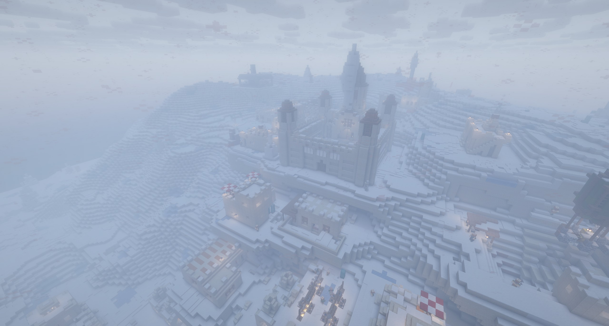

## 02. Wüstenfestung bei klarem Himmel
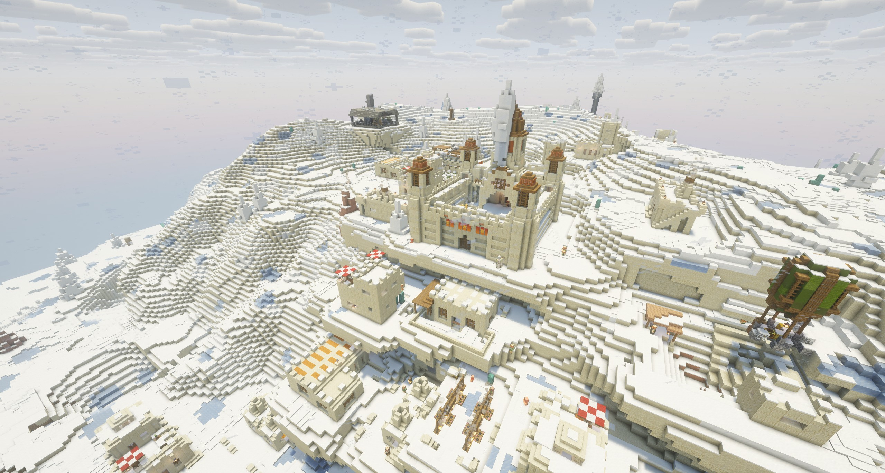

## 03. Verlassene MineColonies-Siedlung in der Taiga
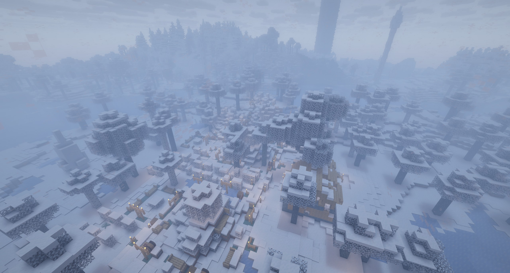

## 04. Kolosseum (When Dungeons Arise)
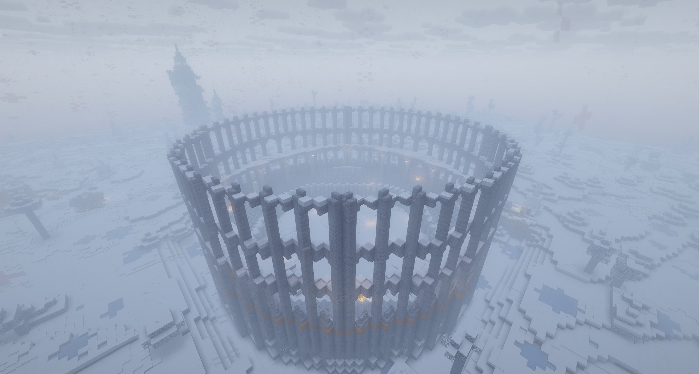

## 05. Leuchtturm (When Dungeons Arise)
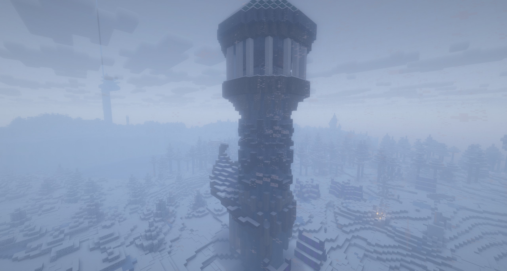

## 06. Taiga-Villa (Repurposed Structures)
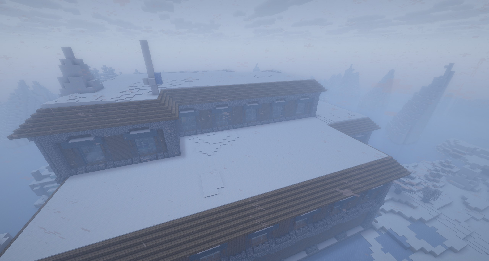

## 07. Illager-Korsar im gefrorenen Meer
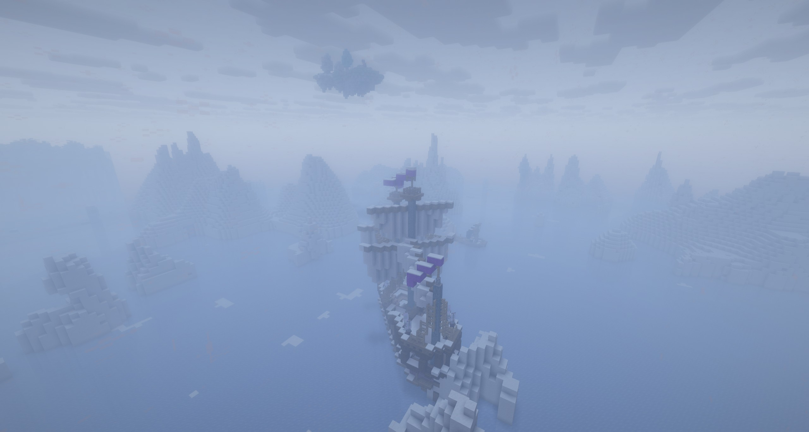

## 08. Iglu (Epic Structures)
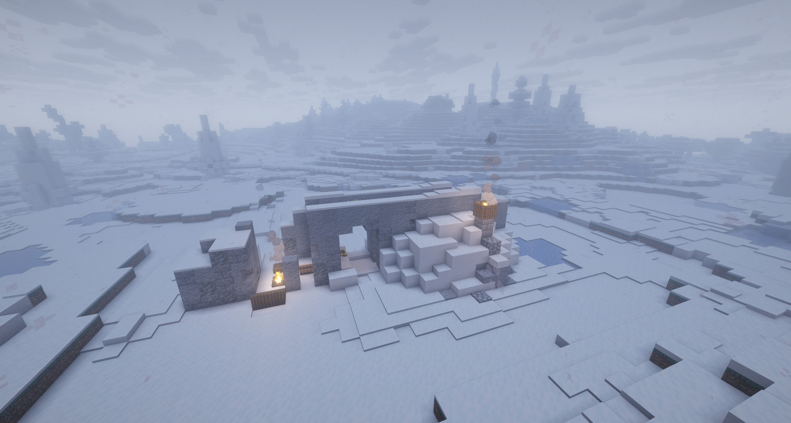

## 09. Schneeverwehungen in der Ebene
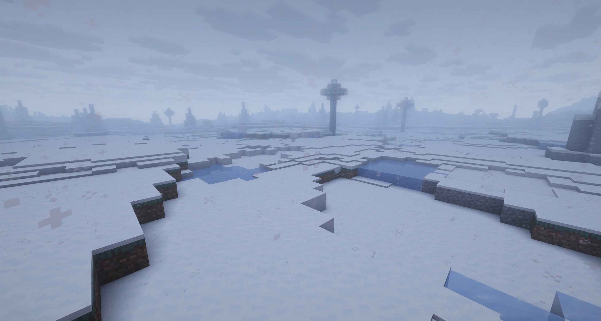

## 10. Schneeverwehungen aus der Nähe (1–5 Schichten)
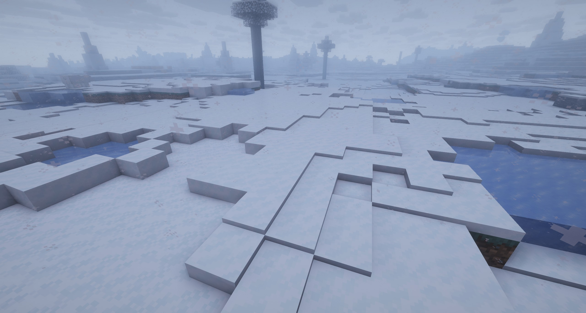

## 11. Weihnachtsszene bei Tag
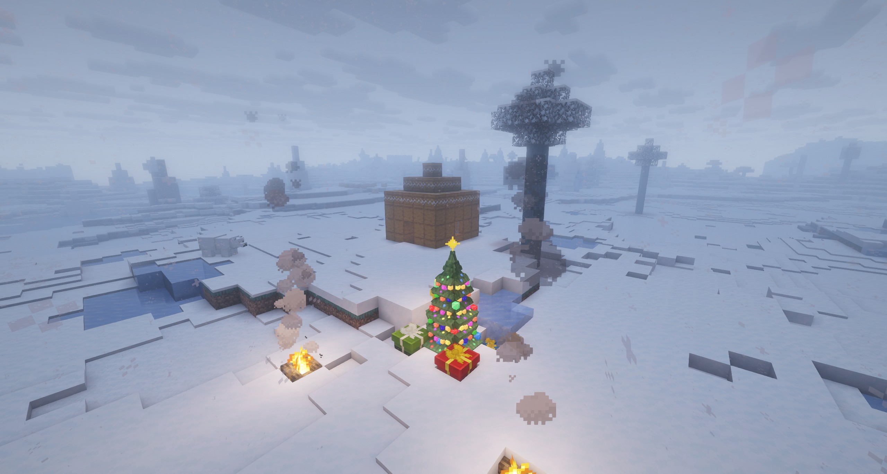

## 12. Weihnachtsszene in der Dämmerung
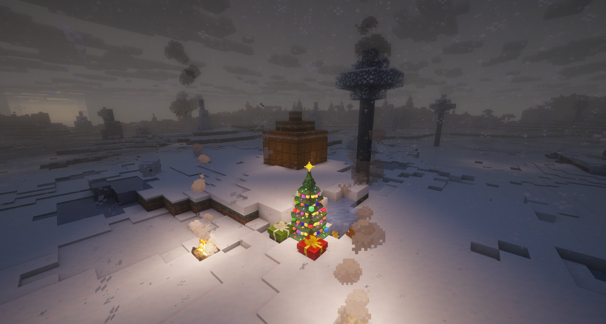

## 13. Weihnachtsszene bei Nacht
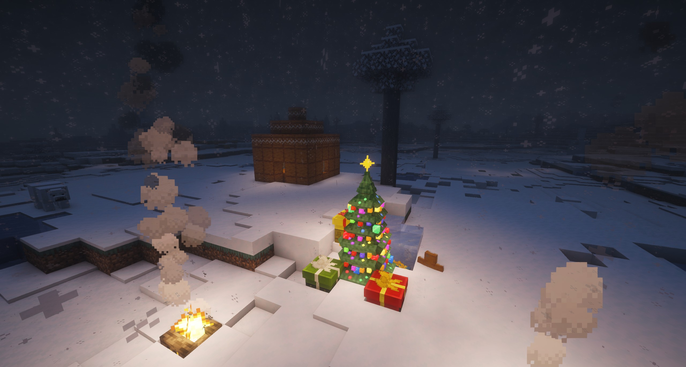

## 14. Frostmaw, Frost Bear und Lebkuchen-Golem
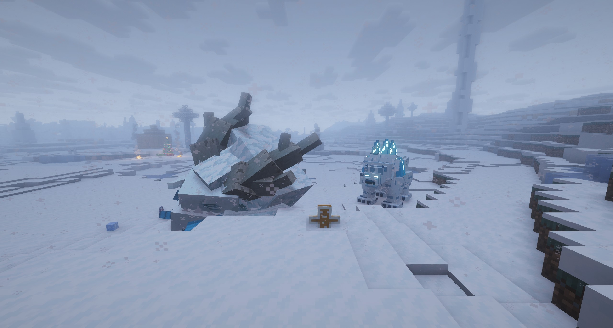

## 15. Siedlung im Whiteout-Sturm
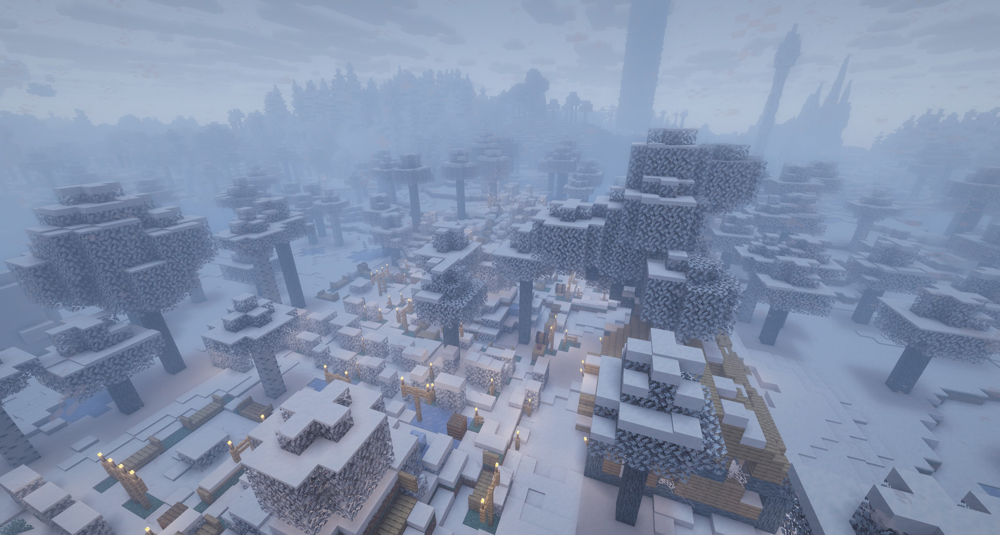

